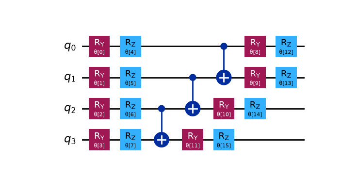

# Ising Model — VQE using Qiskit

A small project exploring the Variational Quantum Eigensolver (VQE) for spin-½ Ising systems. Each spin site is represented by **one qubit**. The aim is to study ground-state energies, different interaction geometries, and the effects of noise.

The Hamiltonian is given by

$$
H = -\sum_{i<j}J_{ij}Z_iZ_j-\sum_i h_iZ_i-\sum_i g_iX_i,
$$

where $J_{ij}$ describes the spin-spin interactions, while $h_i$ and $g_i$ represent the longitudinal and transverse magnetic fields, respectively.

The initial state $\ket{0^{\otimes n}}$ is sent through the parameterized quantum circuit ([Fig. 1](#fig-1)), which applies $U(\vec{\theta})$ to prepare the trial state

$$
\ket{\psi(\vec{\theta})}=U(\vec{\theta})\ket{0^{\otimes n}}.
$$

VQE then minimizes the expectation value $E(\vec{\theta})=\bra{\psi(\vec{\theta})}H\ket{\psi(\vec{\theta})}$ by iteratively adjusting $\vec{\theta}$ using a classical optimizer.

For example, $\vec{\theta}=\vec{0}$ gives $\ket{\psi(\vec{\theta})}=\ket{0^{\otimes n}}$ and $\vec{\theta} = (\pi/2, ..., \pi/2, 0, ..., 0)$, where the there are $n$ angles equal $\pi/2$, and $2n$ angles equal $0$ ($\theta$ has $4n$ parameters), gives $\ket{\psi(\vec{\theta})}=\ket{+^{\otimes n}}$. 

## Adiabatic quantum computing
Adiabatic quantum computing is implemented for the Ising-Hamiltonian, preparing a state $\ket{\psi(\vec{\theta})}=\ket{+^{\otimes n}}$, i.e. the ground state of 

$$
H_{\mathrm{initial}}=-g_{\mathrm{initial}}\sum_i X_i,
\qquad g_{\mathrm{initial}}>0.
$$

The system is then evolved under the time-dependent Hamiltonian

$$
H(s)=(1-s)H_{\mathrm{initial}}+sH_{\mathrm{final}},
\qquad s=\frac{t}{T},
$$

where $H_{\mathrm{final}}$ is the chosen Ising Hamiltonian and $T$ is the total evolution time.

<a id="fig-1"></a>
<p align="center">
  
  <br>
  <em>Figure 1: Parameterized quantum circuit used as the VQE ansatz.</em>
</p>

Various noise models can be introduced to simulate imperfections in quantum hardware. The table below summarizes their physical interpretation, corresponding Qiskit Aer functions, and current implementation status.

| Noise model | Physical meaning | Qiskit function | Implementation |
|---|---|---|---|
| Depolarizing | Randomization of the quantum state due to gate imperfections | [`depolarizing_error`](https://qiskit.github.io/qiskit-aer/stubs/qiskit_aer.noise.depolarizing_error.html) | Implemented (CX gates) |
| Bit-flip | Unwanted Pauli-X operations | [`pauli_error`](https://qiskit.github.io/qiskit-aer/stubs/qiskit_aer.noise.pauli_error.html) | Implemented |
| Phase-flip | Unwanted Pauli-Z operations | [`pauli_error`](https://qiskit.github.io/qiskit-aer/stubs/qiskit_aer.noise.pauli_error.html) | Implemented |
| Amplitude damping | Energy relaxation from $\lvert1\rangle$ to $\lvert0\rangle$ | [`amplitude_damping_error`](https://qiskit.github.io/qiskit-aer/stubs/qiskit_aer.noise.amplitude_damping_error.html) | Implemented |
| Phase damping | Loss of phase coherence, described by $T_{\phi}$ | [`phase_damping_error`](https://qiskit.github.io/qiskit-aer/stubs/qiskit_aer.noise.phase_damping_error.html) | Implemented |
| Thermal relaxation | Energy relaxation and decoherence, characterized by $T_1,T_2$ | [`thermal_relaxation_error`](https://qiskit.github.io/qiskit-aer/stubs/qiskit_aer.noise.thermal_relaxation_error.html) | Implemented |
| Coherent gate errors | Systematic errors, such as gate over-rotations | [`coherent_unitary_error`](https://qiskit.github.io/qiskit-aer/stubs/qiskit_aer.noise.coherent_unitary_error.html) | Not implemented yet |
| Readout errors | Incorrectly recording measurement results | [`ReadoutError`](https://qiskit.github.io/qiskit-aer/stubs/qiskit_aer.noise.ReadoutError.html) | Not implemented yet |
| Reset errors | Imperfect qubit reset operations | [`reset_error`](https://qiskit.github.io/qiskit-aer/stubs/qiskit_aer.noise.reset_error.html) | Not implemented yet |


### Qubit relaxation and coherence times

Three characteristic times describe decoherence in quantum systems:

- **$T_1$ (energy relaxation time):** Characterizes the decay from the excited state $\ket{1}$ to the ground state $\ket{0}$:

  $$
  P_1(t)=P_1(0)e^{-t/T_1}.
  $$

- **$T_2$ (coherence time):** Characterizes the decay of off-diagonal density-matrix elements, including contributions from energy relaxation and pure dephasing:

  $$
  \rho_{01}(t)=\rho_{01}(0)e^{-t/T_2}.
  $$

- **$T_\phi$ (pure dephasing time):** Characterizes the loss of phase coherence without energy relaxation.

Under a standard Markovian noise model, these times are related by

$$
\boxed{\frac{1}{T_2}=\frac{1}{2T_1}+\frac{1}{T_\phi}}.
$$

Setting $P_1(0) = 1$ and $\rho_{01} = 1$, the corresponding probabilities for amplitude damping and phase damping over a time interval $t$ take the form

$$
p_{\mathrm{amplitude}}=1-P_1(t)=1-e^{-t/T_1},
\qquad
p_{\mathrm{phase}}=1-\rho_{01}(t) = \frac{1-e^{-t/T_\phi}}{2}.
$$


## Setup
Requires Python 3 and `pip`.
### Using GNU Make
If GNU Make is installed, the easiest is to run `make setup`. The Makefile creates `.venv` and installs the requirements without activating the environment. For interactive use, activate it using the appropriate command below; repeat activation in each new terminal.

### Virtual Environment
Create a virtual environment in the project directory and install the dependencies.

**macOS / Linux (Bash):**

```bash
python3 -m venv .venv
source .venv/bin/activate
python -m pip install -r requirements.txt
```

**Windows (PowerShell):**

```powershell
py -3 -m venv .venv
.\.venv\Scripts\Activate.ps1
python -m pip install -r requirements.txt
```

**Windows (Git Bash / MSYS2 Bash, with standard Windows Python):**

```bash
py -3 -m venv .venv
source .venv/Scripts/activate
python -m pip install -r requirements.txt
```

## Run

With the environment activated:

```bash
python VQE.py
```

Or, with GNU Make (no activation needed):

```bash
make run
make run ARGS="--qubits 8 --field 1.0"
make test
```

## State-vector memory

An $N$-qubit state has $2^N$ complex amplitudes. In double precision (`complex128`), each amplitude has a 64-bit real part and a 64-bit imaginary part: **8 + 8 = 16 bytes**. Thus the state vector alone requires $2^N \times 16$ bytes.

| Qubits | Amplitudes | State-vector memory |
| ---: | ---: | ---: |
| 8 | 256 | 4 KiB |
| 16 | 65,536 | 1 MiB |
| 24 | 16,777,216 | 256 MiB |
| 30 | 1,073,741,824 | 16 GiB |
| 40 | 1,099,511,627,776 | 16 TiB |

These estimates exclude simulator overhead and density-matrix storage.

## Notes / To do

- [ ] Explain the Hamiltonian and variational ansatz
- [ ] Compare VQE with exact diagonalization
- [ ] Explore system size and interaction geometry
- [ ] Investigate optimization, circuit depth, and noise

## References

- [Qiskit Aer simulation guide](https://quantum.cloud.ibm.com/docs/en/guides/simulate-with-qiskit-aer)
- [Scipy.COBYLA](https://docs.scipy.org/doc/scipy/reference/optimize.minimize-cobyla.html)
- [Qiskit.SPSA](https://qiskit-community.github.io/qiskit-algorithms/stubs/qiskit_algorithms.optimizers.SPSA.html)